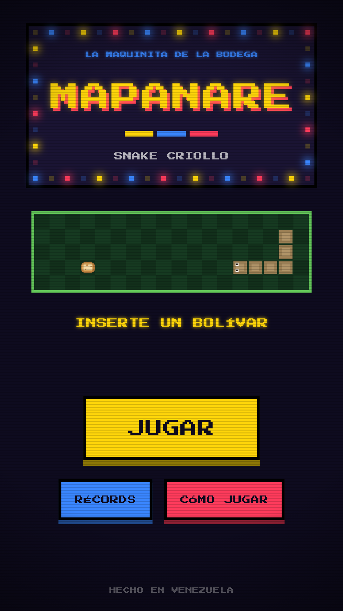
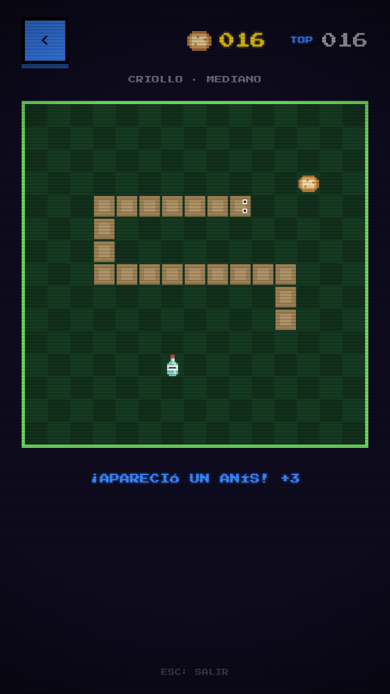
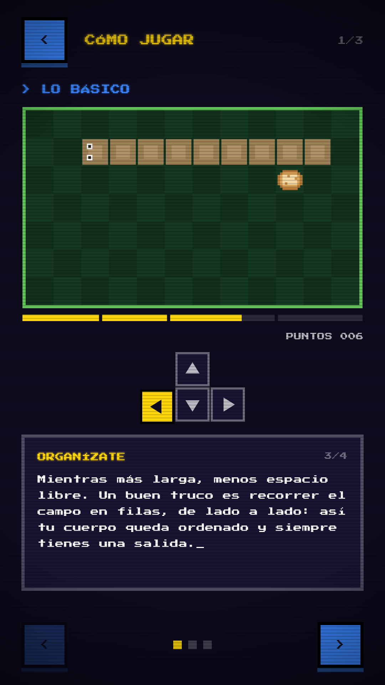

# Mapanare

Snake con estética arcade retro y temática venezolana, hecho en Flutter. 

<p align="center">
  
  
  
</p>

## Características

- **Dos modos de juego**
  - **Clásico:** snake tradicional.
  - **Criollo:** agrega dos eventos.
    - Botella de anís: +3 puntos, pero invierte los controles durante 5 s.
    - Apagones: el campo se oscurece y solo queda visible el área alrededor de la cabeza.
- **Tres tamaños de campo** (10×10, 15×15 y 20×20) y seis comidas a elegir.
- **Récords** por modo y por tamaño de campo, guardados en el dispositivo.
- **Tutorial animado:** las escenas se generan con la misma lógica del juego.
- **Gráficos pixel art** dibujados con `CustomPainter`, sin imágenes externas.
- **Controles:** flechas o WASD en teclado, y deslizar el dedo en pantallas táctiles.

## Tecnologías

- [Flutter](https://flutter.dev) / Dart
- [`shared_preferences`](https://pub.dev/packages/shared_preferences) para guardar los récords
- Fuente [Press Start 2P](https://fonts.google.com/specimen/Press+Start+2P)
- Despliegue web en Vercel

## Ejecutar en local

Requiere el [SDK de Flutter](https://docs.flutter.dev/get-started/install).

```bash
git clone https://github.com/Sneider22/mapanare.git
cd mapanare
flutter pub get
flutter run            # elegir dispositivo: Chrome, emulador o teléfono
```

Pruebas:

```bash
flutter test
```

## Estructura

```
lib/
├── game/      # Lógica del juego (independiente de la interfaz) y récords
├── screens/   # Inicio, preparar partida, juego, récords y tutorial
├── widgets/   # Dibujo del tablero, sprites y componentes de la interfaz
├── howto/     # Guiones de las animaciones del tutorial
└── arcade/    # Colores y tipografía
```
